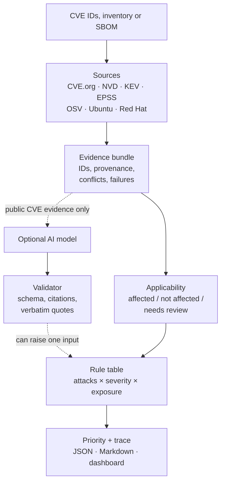

# cveprio

### Evidence-backed CVE prioritization: which vulnerabilities to fix first, and why

[](https://github.com/Be-zerk/cveprio/actions/workflows/tests.yml)

[](LICENSE)

A command-line tool and dashboard that decides which vulnerabilities to fix first, and shows its
working. Give it CVE IDs and a list of your systems (or an SBOM). It collects evidence from CVE.org,
NVD, CISA KEV, FIRST EPSS, OSV.dev and Ubuntu/Red Hat advisories. It checks whether *your* installed versions are affected
and assigns a priority (P1–P4) using a small, documented rule table. Every decision lists its
sources, what is uncertain, and what would change it.

**The problem:** teams often patch in order of CVSS score. A 10.0 that doesn't affect your version
outranks a 7.5 that is being attacked on your internet-facing server. This tool separates the four
things that matter: *is it being attacked*, *how severe is it on paper*, *does it affect my installed
version*, and *how exposed and important is that system*.

> **Status: research prototype, not production software.** Built as a portfolio project. See
> [Limitations](#limitations).


<sub>Offline demo with a fictional company (Northbeam Logistics) and recorded source data.</sub>

**See what each CVE looks like when opened:** [screenshot gallery](docs/SCREENSHOTS.md). It covers
fix now, provisional, needs review, lowered by a declared protection, not affected, cancelled, and
cannot assess yet.

**In the dashboard, the blue links and markers are clickable.** Each opens more detail:
- **▸ details** shows the full explanation behind a line and the evidence it came from.
- **why** explains how a decision differs from ranking by severity score alone.
- **CVE numbers** jump to that CVE's card.
- **Evidence IDs**, the small grey tags such as `KEV` or `NVD.cvss.1` inside "details", are clickable too. They jump to the source entry, with its URL and retrieval time.

Grey section headings such as *Technical details* and *Evidence* expand the specialist information.
GitHub shows `dashboard.html` as source code, so run the demo to click through it.

## Try the offline demo

```bash
git clone https://github.com/Be-zerk/cveprio.git
cd cveprio
python3 -m venv .venv && source .venv/bin/activate
pip install -e ".[dev]"            # downloads packages from PyPI (needs network once)
cveprio demo                       # runs fully offline from recorded data
cveprio serve out/demo             # open http://127.0.0.1:8765/dashboard.html
```

Installation needs network access to download packages. **The demo itself makes no network
requests**: it replays real API responses recorded on 2026-10-10 (`fixtures/demo/`). Every output is
labelled `OFFLINE DEMO`. The company inventory is fictional, and the AI section shows **scripted
examples written for the demo**, labelled as such, not model output. Walkthrough:
[docs/DEMO.md](docs/DEMO.md).

**Use it on your own systems:** follow the [step-by-step guide](docs/USAGE.md#use-it-on-your-own-systems-step-by-step).
It covers describing your systems, an optional free NVD key, running against live data, and optionally a
local AI model with Ollama ([how to run Ollama safely](docs/MODEL_PROVIDERS.md#using-ollama-safely)).

## What it does

- **Collects evidence with provenance:** every fact has an ID, source, URL and retrieval time.
  Failed sources are reported as failed, never treated as "no".
- **Checks affected versions conservatively:** compares the installed version with CNA and NVD
  ranges, or with Ubuntu/Red Hat advisories for distribution packages. When it is ambiguous, the
  answer is *needs review*.
- **Applies business context:** internet exposure, importance and declared protections move the
  priority by documented steps. Missing context makes a decision *provisional* rather than
  assuming "low".
- **Explains each decision:** a step-by-step rule trace, known vs. uncertain facts, "what would
  change this", and a comparison with severity-only ranking.
- **Optional AI analysis, checked:** a model (local Ollama, any OpenAI-compatible server, or Anthropic)
  can describe exploit difficulty. Each claim must cite evidence and quote it word for word, or it
  is removed. With `--auto-resolve`, it can also read vendors' version wording to settle some
  *needs review* cases, under strict checks (below).
- **Outputs:** JSON, Markdown and a self-contained HTML dashboard with no external requests. Also
  discovers CVEs from an inventory or SBOM (CycloneDX / SPDX JSON).

## How it works



**The model never assigns the priority.** Its validated output can reach the decision in two
narrow, labelled ways:

1. **Attack likelihood (always on with a model).** If there is no strong exploitation signal and the
   model rates exploit development as "low" with at least two claims that passed validation,
   exploitation becomes *attacks likely*. That can only raise a priority (to P2, or P1 when an
   affected system is highly exposed and severity is high or critical). Code: `exploitation_level()`
   in [cveprio/prioritize.py](cveprio/prioritize.py).
2. **Reading vendor version wording (only with `--auto-resolve`).** Some records state versions in
   prose ("All versions prior to 26.6.5"), which otherwise ends in *needs review*. Common wordings
   are read by **code**, from exact patterns that must match the whole sentence (no AI involved).
   Only unusual wording goes to the model, which returns version ranges with an exact quote; the
   checker verifies the quote and every version in it, and code does the comparison. A model's
   reading can confirm *affected*, but it can **never mark a system *not affected* unless a
   structured source (such as NVD's ranges) independently agrees**. It cannot clear anything by
   calling versions "fixed", and open-ended wording ("all older versions") or stated conditions
   block clearing entirely. Reading the wording also never overrides another source's open
   question (such as NVD's "only with Oracle JDK"). Code: [cveprio/llm/versions.py](cveprio/llm/versions.py);
   adversarial tests: [tests/test_auto_resolve.py](tests/test_auto_resolve.py).

Model judgements from either path are labelled as such in the report. Only public CVE text is sent to the model: never
the inventory, system names, business context or installed versions.

More: [architecture](docs/ARCHITECTURE.md) · [prioritization rules](docs/PRIORITIZATION.md) ·
[evaluation](docs/EVALUATION.md) · [model providers](docs/MODEL_PROVIDERS.md) · [changelog](CHANGELOG.md).

## Worked examples (from the offline demo)

All from [examples/demo-output/report.md](examples/demo-output/report.md); systems are fictional.

| Question | What the demo shows |
|---|---|
| **Why not just sort by CVSS?** | 5 of 7 published CVEs get a different answer. The xz backdoor CVE-2024-3094 scores 10.0, but the installed xz 5.4.6 is outside every affected range, so: *not affected*. HTTP/2 Rapid Reset CVE-2023-44487 scores 7.5 (P2 by score), but it is on CISA's attacked list and hits an internet-facing, high-importance web portal, so: **P1**. |
| **How do versions and context matter?** | OpenSSH CVE-2024-6387 affects `bastion-01` (9.6p1, internet-facing), which gets **P1**. The same CVE on `ops-ubuntu-02` is *not affected*: Ubuntu fixed it in `1:9.6p1-3ubuntu13.3` and `13.4` is installed. Distributions backport fixes, so upstream version ranges alone would give the wrong answer. |
| **What stays visible when data is missing?** | If a source fails, the run exits with code 3, the report says "partial result", and the dashboard lists the failed lookups. Nothing is filled in (`test_degraded_run_is_visible_not_filled_in`). A reserved CVE with no published details is shown as *Cannot assess yet*, with "nothing about this flaw is known yet", never "no action needed" (`test_missing_records_are_not_presented_as_safe`). Absence from KEV is never read as "not exploited". |
| **What does quote validation catch?** | In the scripted OpenSSH example, 3 of 9 claims are removed. One quote does not appear in the cited evidence ("succeed in under a minute"). One claim cites an evidence ID that doesn't exist. One cites nothing. A rating claiming in-the-wild exploitation is corrected to "public exploit claimed". It **cannot** catch a wrong conclusion drawn from a genuine quote. |
| **Where must a human decide?** | Spring4Shell CVE-2022-22965 on `web-portal-01` is *needs review*. The vendor states versions in free text, and NVD only marks it affected with a specific JDK, which the inventory does not record. The dashboard says what to check. |

## Evaluation (small, and honest about it)

| Set | Result | Caveat |
|---|---|---|
| 14 development cases ([results](evaluation/results/eval-none.md)) | Rules within the reference set 13/14; CVSS-only baseline 6/14; applicability 14/14 | Same CVEs used while building the tool; labels drafted with AI help and reviewed by the author |
| 20 held-out recent CVEs ([results](evaluation/results/eval-holdout-none.md)) | **4 of 20 labelled so far**: applicability 3/4, no unsafe answers, decisions 2/4 | Far too few to measure accuracy; one label fix after the first run is disclosed |
| Local model qwen2.5:3b ([results](docs/EVALUATION.md#recorded-results-2026-10-10)) | Usability rating matched the facts 0/6; priority never changed by the model | A small CPU model; grounding passes do not mean the reasoning is correct |
| Auto-resolve (`--auto-resolve`) ([results](docs/EVALUATION.md#auto-resolution-2026-10-12-development-result)) | Applicability 14/14 (dev) and 4/4 (held-out), 0 unsafe; resolves ScreenConnect (h05) by exact wording pattern. The small AI model resolved nothing; every misreading was rejected or contained | Development result: designed after seeing h05; needs new held-out cases |

None of this is a measure of real-world predictive accuracy. Details: [docs/EVALUATION.md](docs/EVALUATION.md).

## Limitations

- **Prototype.** Not hardened or load-tested; single user; `serve` has no authentication and binds to `127.0.0.1` only.
- **Small evaluation** (above). The rules have known blind spots: a supply-chain backdoor with no KEV listing gets P2 on an internal system, where many analysts would say P1.
- **Applicability is partial.** Free-text version ranges, platform-conditional NVD entries and distributions other than Ubuntu/RHEL go to *needs review*. Results depend on accurate inventory identifiers.
- **AI claims are grounded, not fact-checked.** A real quote can support a wrong conclusion. Prompt-injection detection is heuristic; the defence is structural (data-only prompt, validation, limited influence).
- **Exploit evidence is shallow by design.** Exploit references and CISA SSVC are treated as claims. The tool never downloads or runs exploit code.
- **Offline fixtures go stale.** Use live mode for current data. DNS rebinding between validation and connection is not fully prevented (mitigated by a fixed host allowlist).

## Development

```bash
pytest                                  # offline tests
CVEPRIO_LIVE_TESTS=1 pytest -m live     # live API checks (network)
ruff check cveprio tests && mypy cveprio
cveprio evaluate                        # deterministic evaluation → evaluation/results/
```

CI ([tests.yml](.github/workflows/tests.yml)) runs ruff, mypy, the offline tests and the demo on
Python 3.11–3.13 for every push and pull request. Current status: see the badge above and
[PROGRESS.md](PROGRESS.md).

## Authorship and AI assistance

**The project author** (Suayip Ada) defined the problem, scope, requirements and evaluation approach,
and made the design and policy decisions. Examples: keeping the declared-protection rule at P2
after the held-out disagreement, and what the dashboard shows by default. They also reviewed the 14
development reference judgements and labelled the first held-out cases. **The code, tests,
fixtures and documentation were written by Claude Code, an AI coding assistant,** in sessions
the author directed on 2026-10-10 and 2026-10-11.

The idea of using language models to judge how practical exploit development is for new CVEs
came from a suggestion by Matthew Devost. This project extends it with evidence provenance,
applicability matching and transparent rules. The project is not endorsed by Matthew Devost.

*This product uses the NVD API but is not endorsed or certified by the NVD.* Source attributions
appear in every report.

## License

[MIT](LICENSE) © 2026 Suayip Ada. Third-party data keeps its own terms (NVD, CISA KEV, FIRST EPSS,
OSV.dev, Ubuntu, Red Hat); see the attributions in each report.
