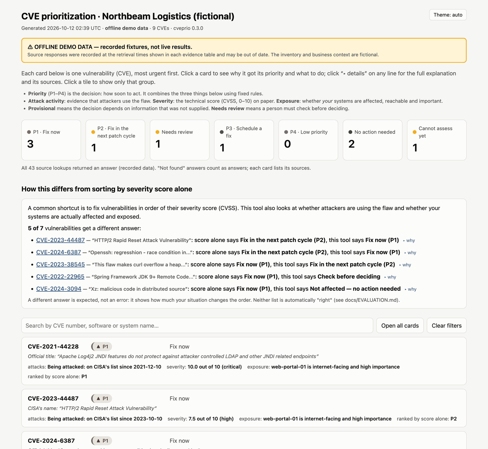
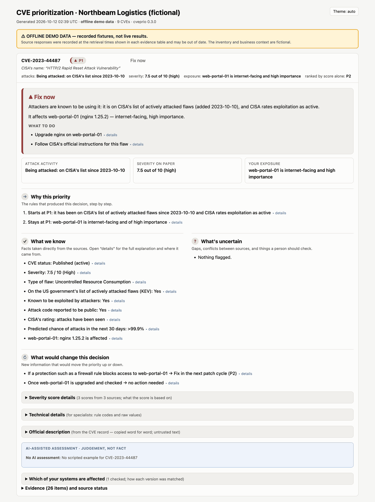
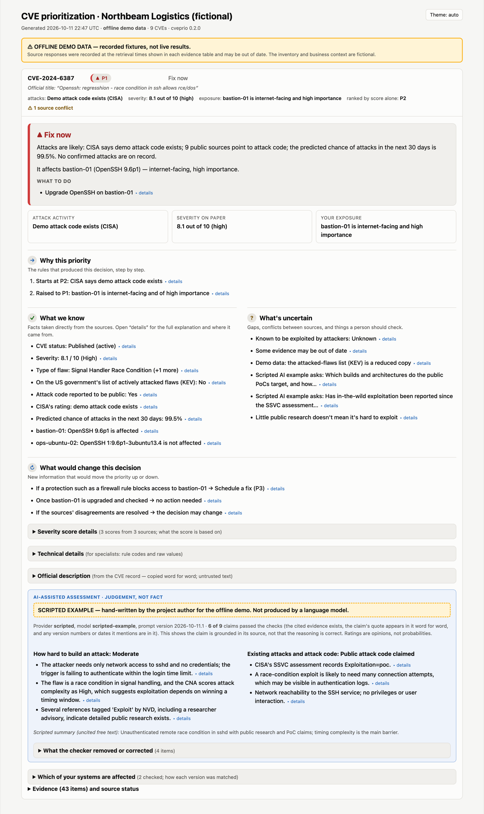
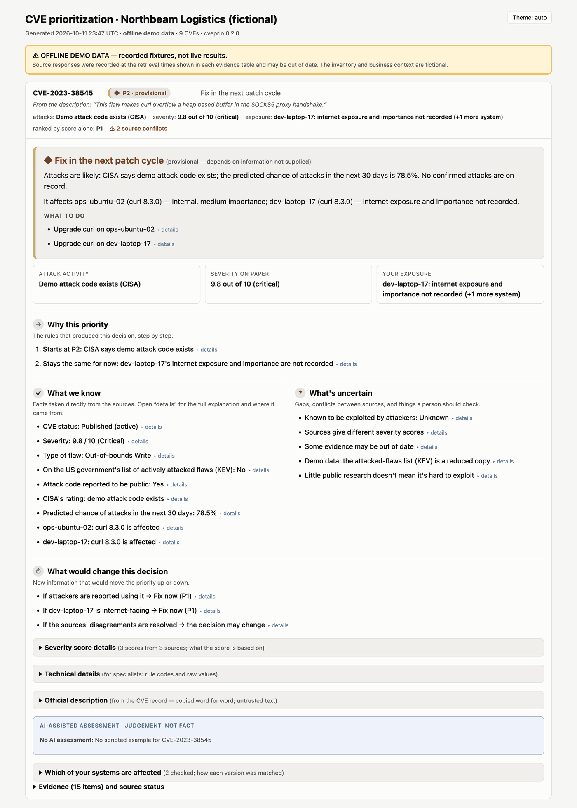
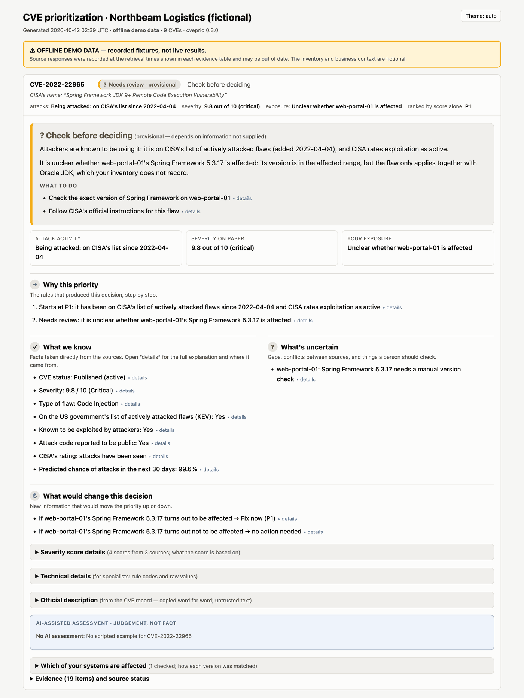
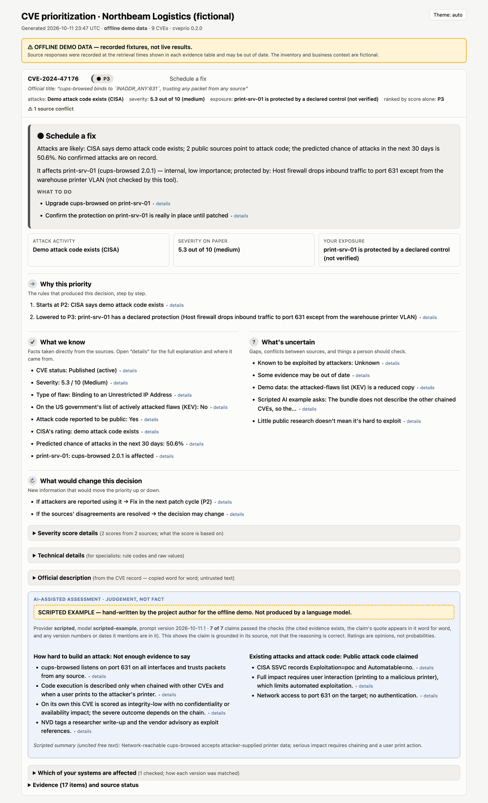
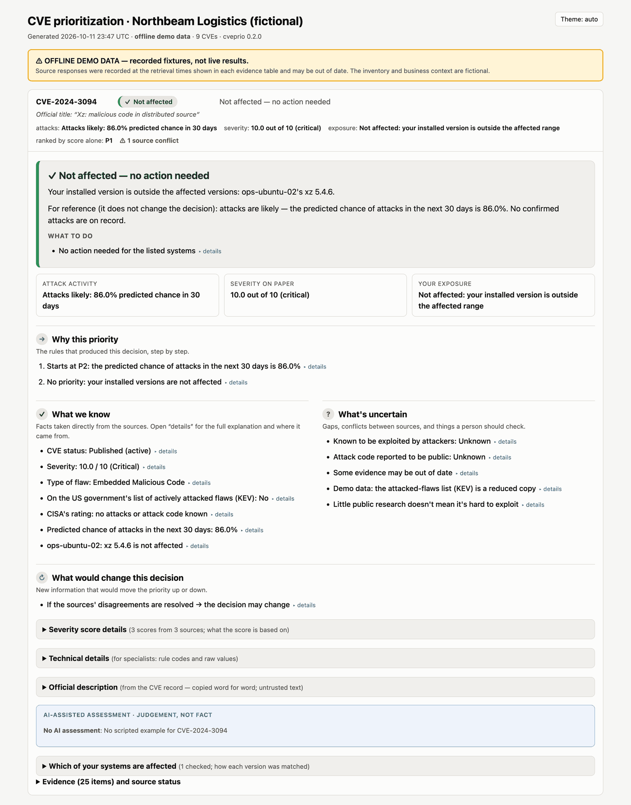
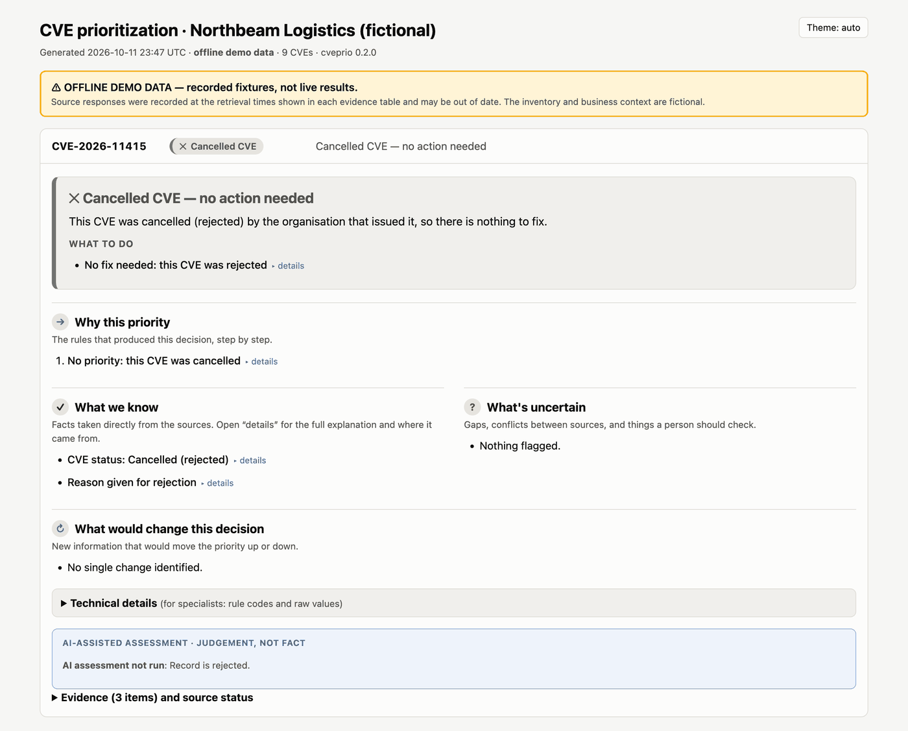
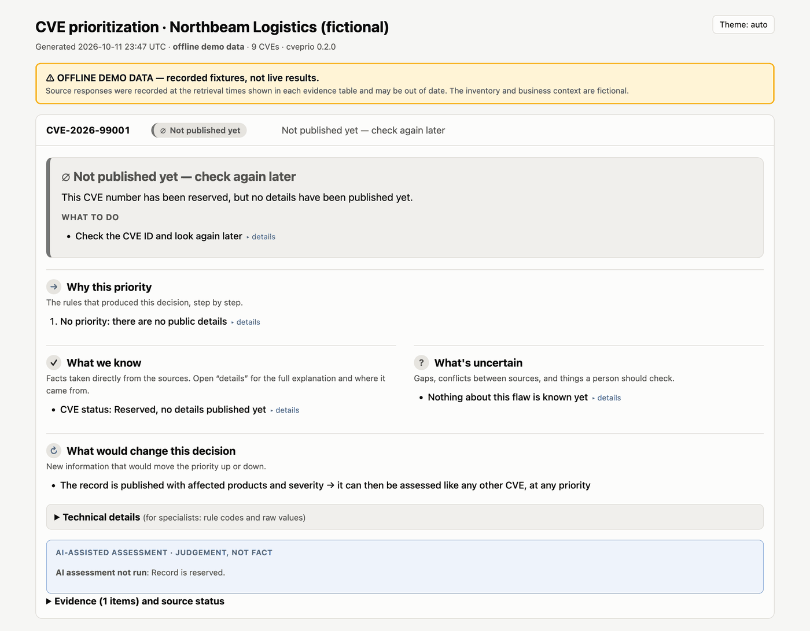

# Screenshots

Real captures of the dashboard from `cveprio demo` (offline, recorded source data, fictional
company "Northbeam Logistics"). Each image shows one CVE card opened, the way a user sees it
after clicking it. The other cards are hidden only to keep each image to one CVE. The blue
"▸ details" links and the grey sections (*Severity score details*, *Technical details*,
*Evidence*…) open further information when clicked in the running dashboard.

| Outcome | What it shows |
|---|---|
| [Overview](#overview) all 9 | Priority tiles, source status, the comparison with severity-only ranking |
| [Fix now: attacked, exposed](#fix-now-attacked-and-internet-facing) CVE-2023-44487 | A 7.5 score becomes P1 because it is being attacked and the system faces the internet |
| [Fix now: AI section shown](#fix-now-with-the-ai-section) CVE-2024-6387 | The scripted AI example and what the checker removed |
| [Provisional](#provisional-context-missing) CVE-2023-38545 | Missing business context makes the decision provisional, never "low" |
| [Needs review](#needs-review) CVE-2022-22965 | The tool cannot tell if the system is affected, says why and what to check |
| [Declared protection](#lowered-by-a-declared-protection) CVE-2024-47176 | A firewall the operator declared lowers the priority one step, marked "not verified" |
| [Not affected](#not-affected) CVE-2024-3094 | A 10.0 score, but the installed version is outside the affected range |
| [Cancelled CVE](#cancelled-cve) CVE-2026-11415 | A rejected CVE: nothing to fix |
| [Cannot assess yet](#cannot-assess-yet) CVE-2026-99001 | A reserved CVE with no published details: unknown, not safe |

## Overview

## Fix now: attacked and internet-facing

CVE-2023-44487 (HTTP/2 Rapid Reset). Ranked by score alone it would be P2; it is on CISA's list of
actively attacked flaws and affects an internet-facing, high-importance web portal, so it is P1.

## Fix now, with the AI section

CVE-2024-6387 (OpenSSH). One server is affected; the Ubuntu package on another is not, according to
Ubuntu's advisory. The blue box is a **scripted example** written for the demo, not model output.
It shows that 6 of 9 claims passed the checks; "What the checker removed" lists the other 3.

## Provisional: context missing

CVE-2023-38545 (curl). The laptop's internet exposure and importance are not recorded, so the
decision is marked *provisional*. Two severity scores disagree; both are shown.

## Needs review

CVE-2022-22965 (Spring4Shell). The version is in the affected range, but NVD lists it as affected
only together with Oracle JDK, which the inventory does not record. The tool asks a person to check
instead of guessing, and shows that it would be P1 if affected.

## Lowered by a declared protection

CVE-2024-47176 (cups-browsed). The operator declared a firewall control for the print server; the
priority moves down one step and the card says the tool did not verify the control.

## Not affected

CVE-2024-3094 (xz backdoor). Severity 10.0, but the installed xz 5.4.6 is outside every affected range.

## Cancelled CVE

CVE-2026-11415 was rejected by the organisation that issued it, so there is nothing to fix.

## Cannot assess yet

CVE-2026-99001 is reserved with no published details. The card says nothing is known yet, which is
not the same as safe, and what would change that.

